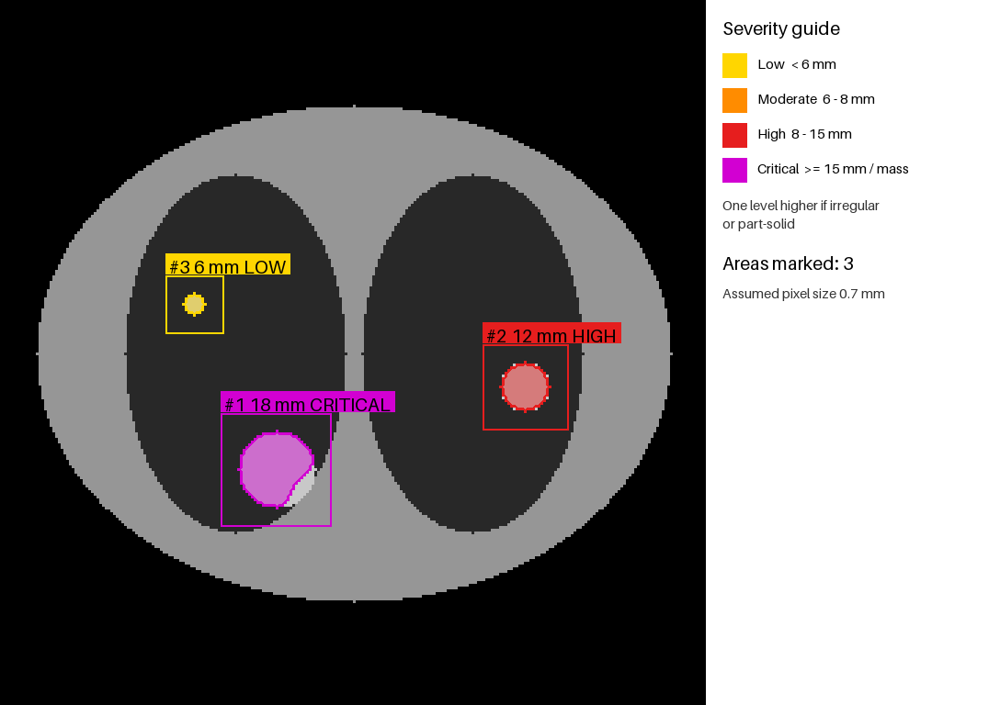

# Lung Cancer Imaging Analysis

Patient-matched lung cancer CT analysis on the TCIA collection
[CMB-LCA](https://www.cancerimagingarchive.net/collection/cmb-lca/). This project reuses the
structure of [AML-Imaging-Analysis](https://github.com/mfrendy-maker/AML-Imaging-Analysis)
(TCIA metadata snapshot, same-patient cohort, similarity, clustering, longitudinal CT
biomarkers, CT upload demo) and adds CT lesion detection, severity grading and
abnormality classification.

Research use only. Not for clinical diagnosis. Feel free to use!

## Data citation and usage

Data come from The Cancer Imaging Archive (TCIA), collection CMB-LCA (Cancer Moonshot
Biobank - Lung Cancer). Cite the collection using the DOI on its
[collection page](https://www.cancerimagingarchive.net/collection/cmb-lca/) and follow the
[TCIA Data Usage Policy](https://www.cancerimagingarchive.net/data-usage-policies-and-restrictions/).
Raw DICOM is not stored in Git (`data/tcia_downloads/` is ignored).

## Citation

GitHub shows a "Cite this repository" button from [CITATION.cff](CITATION.cff).

**Software**

> Setyawan, M. F. (2026). *Lung Cancer Imaging Analysis* (Version 0.1.0) [Computer software]. https://github.com/mfrendy-maker/Lung-Cancer-Imaging-Analysis

```bibtex
@software{setyawan_lung_cancer_imaging_analysis_2026,
  author  = {Setyawan, Muhamad Frendy},
  title   = {Lung Cancer Imaging Analysis},
  year    = {2026},
  version = {0.1.0},
  url     = {https://github.com/mfrendy-maker/Lung-Cancer-Imaging-Analysis},
  license = {MIT}
}
```

**Dataset (required by TCIA)**

> Cancer Moonshot Biobank. (2022). *Cancer Moonshot Biobank - Lung Cancer Collection (CMB-LCA)* (Version 12) [dataset]. The Cancer Imaging Archive. https://doi.org/10.7937/3cx3-s132

Acknowledgement requested by the program: "Data used in this publication were generated by the National Cancer
Institute's Cancer Moonshot Biobank." CMB-LCA images are licensed CC BY 4.0 (head images are restricted); follow the
[TCIA Data Usage Policy](https://www.cancerimagingarchive.net/data-usage-policies-and-restrictions/).

## Quick start

```
python -m pip install -e .
lung-imaging --collection CMB-LCA --output-dir data      # TCIA metadata, similarity matrix
lung-lesion run --max-series 1                           # download + convert + analyse in one step
lung-lesion download --max-series 3                      # CT series from CMB-LCA via the NBIA API
lung-lesion convert <dicom_dir> data/ct.nii.gz           # DICOM -> NIfTI
lung-lesion analyse data/ct.nii.gz --out outputs         # lesions, severity, PNG overlays (threshold lung mask)
python -m pip install -e ".[segmentation]"               # optional: TotalSegmentator
lung-lesion analyse data/ct.nii.gz --backend totalsegmentator
lung-lesion compare --cancer cancer_cts --normal normal_cts   # cancer vs normal summary CSV
lung-ct-demo                                             # browser CT upload demo (port 8003)
```

Tests: `python -m pytest` (offline; TCIA calls are mocked).

## Pipeline

1. Acquisition: TCIA NBIA API, CMB-LCA collection (`data_fetcher.py`).
2. Same-patient cohort, clinical outcomes, longitudinal change (`cohort.py`, `clinical.py`, `longitudinal.py`).
3. Similarity, clustering, biology report (`analysis.py`, `clustering.py`, `discovery.py`).
4. CT biomarker by response group (`ct_imaging.py`).
5. Lesion analysis: lung mask (threshold-based by default, TotalSegmentator lobes optional), candidates
   (HU > -400 inside the eroded lung, spherical opening to remove vessels, connected components), per-lesion diameter, mean HU, sphericity, type
   (ground-glass / part-solid / solid / spiculated nodule / mass) and severity
   (low / moderate / high / critical, Lung-RADS-style size thresholds). Scan label: normal or abnormal.
   Annotated PNGs are written to `outputs/images/` (`lesions.py`, `segment.py`, `viz.py`).

For normal-lung controls, run `lung-lesion compare` with a folder of CTs that have no lesions;
TotalSegmentator is a segmentation tool, not a normal-CT dataset.

## Example output

## Lesion analysis GUI

```
lung-gui          # http://127.0.0.1:8005/  (set GUI_PORT to change)
```

Upload a lung CT slice (PNG, JPG, TIFF, BMP) or a NIfTI volume. Suspected lesions are filled and outlined
in a severity colour (yellow low, orange moderate, red high, magenta critical), boxed, and labelled with
size and severity, with a legend and a findings table. For 2D images, enter the pixel size in mm so sizes
are meaningful. Images are processed in memory and not stored. Heuristic and unvalidated; not for diagnosis.



(Synthetic chest drawing, not patient data.)

### Consent for tool development

The upload form has an optional consent checkbox, unchecked by default. Without it the image is analysed in memory and
discarded. If ticked, the uploader confirms they are authorised to share the image and have removed identifying
information, and agrees that it may be retained and used to develop, test and improve this tool's analysis module.
The file is saved under `data/training_uploads/` (ignored by Git) with a `.consent.json` record (consent text, version,
timestamp). The tool does not de-identify images or DICOM/NIfTI headers. Consent can be withdrawn by asking the
operator to delete the file and its record.

## Example output

Synthetic volume (a 14 mm solid sphere in simulated lung), not patient data:


### Accessing the GUI

`http://127.0.0.1:8005/` is a loopback address, so it only works on the machine running the server.

| Who | How |
|---|---|
| Same computer | Open `http://127.0.0.1:8005/` in a browser. |
| Same network | The server binds to `127.0.0.1` only by default. Set `LUNG_GUI_HOST=0.0.0.0` and `LUNG_GUI_TOKEN` (required for non-local addresses), allow port 8005 in the firewall, then use `http://<server-ip>:8005/`. |
| Internet | Use a tunnel (temporary URL, only while the machine is on) or deploy to a server. Add access control and a smaller upload limit first, because anyone with the link could upload images. |

Browser or Python both work, since the server speaks plain HTTP. From Python:

```python
import requests

with open("chest.png", "rb") as f:
    r = requests.post(
        "http://127.0.0.1:8005/analyse",   # use the LAN or public address for remote users
        files={"image": ("chest.png", f, "image/png")},
        data={"spacing": "0.7"},           # add "training_consent": "yes" only with the uploader's consent
        timeout=120,
    )
open("result.html", "w", encoding="utf-8").write(r.text)
```

The response is an HTML page, not JSON. A JSON API endpoint is not implemented yet.

### Step by step: opening the GUI from another computer

There are two ways. **Option A** needs nothing from the original laptop and works anywhere. **Option B** lets people on
the same network use the original laptop's copy.

#### Option A: run your own copy (recommended)

1. Install **Python 3.10 to 3.12** from python.org and **Git** from git-scm.com.
2. Open a terminal (PowerShell on Windows, Terminal on macOS or Linux) and download the project:
   ```
   git clone https://github.com/mfrendy-maker/Lung-Cancer-Imaging-Analysis.git
   cd Lung-Cancer-Imaging-Analysis
   ```
3. Create an isolated environment and install the tool:
   ```
   python -m venv .venv
   .venv\Scripts\activate            # macOS/Linux: source .venv/bin/activate
   python -m pip install --upgrade pip
   python -m pip install .
   ```
4. Start the GUI:
   ```
   lung-gui
   ```
   (If the `lung-gui` command is not found, run `python -m lung_imaging_analysis.lung_gui`.)
5. Open **http://127.0.0.1:8005/** in a web browser on that same computer.
6. Click the box to choose a CT image (PNG, JPG, TIFF, BMP, or NIfTI), check the pixel size, and press **Analyse image**.
7. Use **Save as PDF / Print** on the result page to keep a copy. Press `Ctrl+C` in the terminal to stop the server.

Your images stay on your own computer. To use a different port: `set GUI_PORT=9000` (PowerShell: `$env:GUI_PORT="9000"`) before step 4.

#### Option B: use the original laptop over the same network

On the **laptop that hosts the GUI** (in PowerShell, from the project folder with the environment activated):

1. Find its address: run `ipconfig` and note the **IPv4 Address** of the Wi-Fi or Ethernet adapter, for example `192.168.1.25`.
2. Choose an access code and start the server (it refuses to listen on the network without one):
   ```
   $env:LUNG_GUI_TOKEN = "choose-a-long-random-code"
   $env:LUNG_GUI_DEMO  = "1"          # optional: never save uploaded images
   $env:LUNG_GUI_HOST  = "0.0.0.0"
   python -m lung_imaging_analysis.lung_gui
   ```
3. Allow the port through Windows Firewall (run PowerShell **as Administrator** once):
   ```
   New-NetFirewallRule -DisplayName "Lung CT GUI" -Direction Inbound -Protocol TCP -LocalPort 8005 -Action Allow -Profile Private
   ```
4. Keep the laptop switched on, awake and on that network while others use it.

On **each other computer, phone or tablet** (same Wi-Fi or office network):

5. Open a browser and go to `http://<laptop-address>:8005/`, for example `http://192.168.1.25:8005/`.
6. Enter the access code you were given, then upload an image and press **Analyse image**.

If the page does not open: confirm both devices are on the same network (guest Wi-Fi often blocks device-to-device
traffic), re-check the IPv4 address, and check the firewall rule. When finished, press `Ctrl+C` on the laptop and remove
the rule with `Remove-NetFirewallRule -DisplayName "Lung CT GUI"`.

Notes: on a local network the connection is plain HTTP, so the access code and images are not encrypted. Use trusted
networks only. For people outside your network, deploy on a server with HTTPS instead of opening your laptop to the internet.


### Saving the result as a PDF

Result pages have a **Save as PDF / Print** button. In the browser print window choose "Save as PDF". The print
layout drops the buttons, keeps colours, avoids splitting cards across pages and stamps the report with its UTC time.

### Running it for other people (security settings)

The GUI is safe for localhost by default. Before exposing it to a network or the internet, set these environment
variables (all optional unless noted):

| Variable | Purpose | Default |
|---|---|---|
| `LUNG_GUI_HOST` | Address to listen on. Anything other than localhost **refuses to start without a token**. | `127.0.0.1` |
| `LUNG_GUI_TOKEN` | Shared access code. Visitors sign in once (HttpOnly, SameSite=Strict cookie); wrong codes are rate limited. | none (open) |
| `LUNG_GUI_DEMO` | `1` = never save uploads and hide the consent option. | off |
| `LUNG_GUI_MAX_MB` | Largest accepted upload. | `50` |
| `LUNG_GUI_MAX_STORE_MB` | Cap on total consented uploads kept on disk. | `500` |
| `LUNG_GUI_RATE` | Analyses per minute per client. | `10` |
| `LUNG_GUI_TRUST_PROXY` | `1` = use `X-Forwarded-For` for the client address (only behind a trusted proxy or tunnel). | off |
| `GUI_PORT` | Port. | `8005` |

Example for a public demo:

```
$env:LUNG_GUI_TOKEN = "<long random code>"; $env:LUNG_GUI_DEMO = "1"; $env:LUNG_GUI_HOST = "0.0.0.0"
python -m lung_imaging_analysis.lung_gui
```

Responses carry no-store caching, a strict Content-Security-Policy and clickjacking protection, request size is checked
before the body is read, and at most two analyses run at once. Still use HTTPS (a reverse proxy or tunnel), keep demo
mode on unless you have a data-handling plan, and only allow anonymised or sample images. This is not a substitute for
a security review.

## Limitations

- Detection and severity use fixed thresholds, not a trained model. CMB-LCA has little voxel-level
  tumour annotation, so sensitivity and false-positive rates are not measured. A labelled collection
  (for example LIDC-IDRI nodule annotations or NSCLC-Radiomics contours) is needed to validate or
  train a classifier.
- The older `lung-ct-demo` page (port 8003) only reports 2D image statistics. Use `lung-gui` for lesion marking.
- Real-scan check (one CMB-LCA CT series, patient MSB-04096, no ground truth): the 3D pipeline first marked 54
  candidates. Visual review showed contrast-filled vessels, so candidates denser than 150 HU or tube-shaped are now
  rejected, leaving 22 candidates in about 40 seconds. Spot checks of two of the remainder showed a pleural/mediastinal
  interface and a vessel branch point, so expect many false positives. Treat every mark as a candidate to review,
  not a finding. Note that this series is a coronal-style reformat, so the "axial slice" caption can be misleading.

### Result guidance

Result pages include general educational information: possible explanations for the marked appearance, suggested next steps scaled to severity, notes on how medicines are chosen (no doses, not a prescription), personal care and activity advice, warning signs for urgent care, and a schematic normal chest CT for comparison. This content is generic (see `clinical_info.py`), is not personalised, and is not medical advice.
