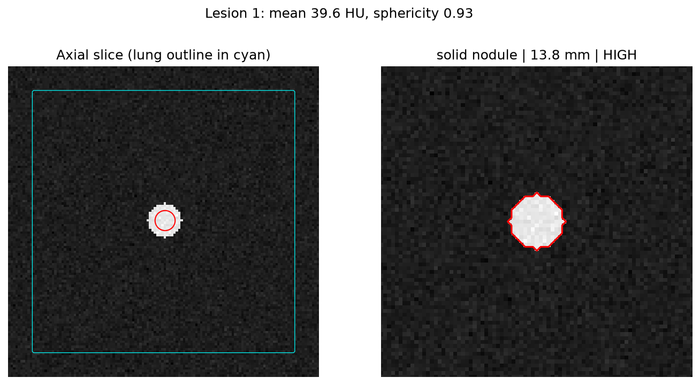

# Lung Cancer Imaging Analysis

Patient-matched lung cancer CT analysis on the TCIA collection
[CMB-LCA](https://www.cancerimagingarchive.net/collection/cmb-lca/). This project reuses the
structure of [AML-Imaging-Analysis](https://github.com/mfrendy-maker/AML-Imaging-Analysis)
(TCIA metadata snapshot, same-patient cohort, similarity, clustering, longitudinal CT
biomarkers, CT upload demo) and adds CT lesion detection, severity grading and
abnormality classification.

Research use only. Not for clinical diagnosis.

## Data citation and usage

Data come from The Cancer Imaging Archive (TCIA), collection CMB-LCA (Cancer Moonshot
Biobank - Lung Cancer). Cite the collection using the DOI on its
[collection page](https://www.cancerimagingarchive.net/collection/cmb-lca/) and follow the
[TCIA Data Usage Policy](https://www.cancerimagingarchive.net/data-usage-policies-and-restrictions/).
Raw DICOM is not stored in Git (`data/tcia_downloads/` is ignored).

## Quick start

```
python -m pip install -e .
lung-imaging --collection CMB-LCA --output-dir data      # TCIA metadata, similarity matrix
lung-lesion run --max-series 1                           # download + convert + analyse in one step
lung-lesion download --max-series 3                      # CT series from CMB-LCA via the NBIA API
lung-lesion convert <dicom_dir> data/ct.nii.gz           # DICOM -> NIfTI
lung-lesion analyse data/ct.nii.gz --out outputs         # lesions, severity, PNG overlays (threshold lung mask)
python -m pip install -e ".[segmentation]"               # optional: TotalSegmentator
lung-lesion analyse data/ct.nii.gz --backend totalsegmentator
lung-lesion compare --cancer cancer_cts --normal normal_cts   # cancer vs normal summary CSV
lung-ct-demo                                             # browser CT upload demo (port 8003)
```

Tests: `python -m pytest` (offline; TCIA calls are mocked).

## Pipeline

1. Acquisition: TCIA NBIA API, CMB-LCA collection (`data_fetcher.py`).
2. Same-patient cohort, clinical outcomes, longitudinal change (`cohort.py`, `clinical.py`, `longitudinal.py`).
3. Similarity, clustering, biology report (`analysis.py`, `clustering.py`, `discovery.py`).
4. CT biomarker by response group (`ct_imaging.py`).
5. Lesion analysis: lung mask (threshold-based by default, TotalSegmentator lobes optional), candidates
   (HU > -400 inside the eroded lung, spherical opening to remove vessels, connected components), per-lesion diameter, mean HU, sphericity, type
   (ground-glass / part-solid / solid / spiculated nodule / mass) and severity
   (low / moderate / high / critical, Lung-RADS-style size thresholds). Scan label: normal or abnormal.
   Annotated PNGs are written to `outputs/images/` (`lesions.py`, `segment.py`, `viz.py`).

For normal-lung controls, run `lung-lesion compare` with a folder of CTs that have no lesions;
TotalSegmentator is a segmentation tool, not a normal-CT dataset.

## Example output

Synthetic volume (a 14 mm solid sphere in simulated lung), not patient data:



## Limitations

- Detection and severity use fixed thresholds, not a trained model. CMB-LCA has little voxel-level
  tumour annotation, so sensitivity and false-positive rates are not measured. A labelled collection
  (for example LIDC-IDRI nodule annotations or NSCLC-Radiomics contours) is needed to validate or
  train a classifier.
- The browser upload demo still reports 2D image statistics only; it does not run the 3D lesion pipeline.
